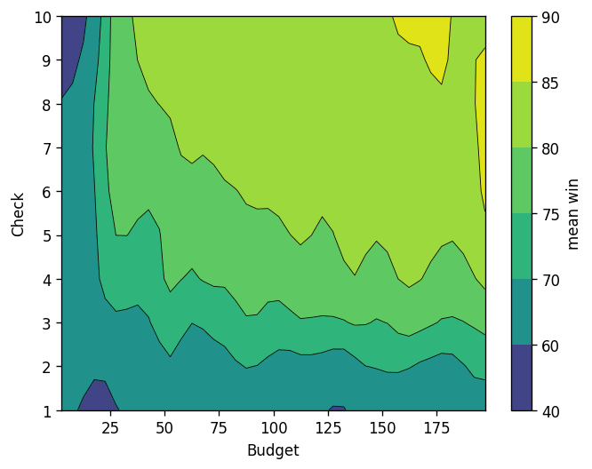
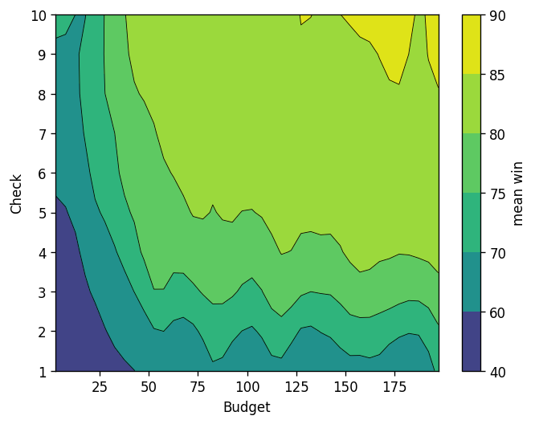
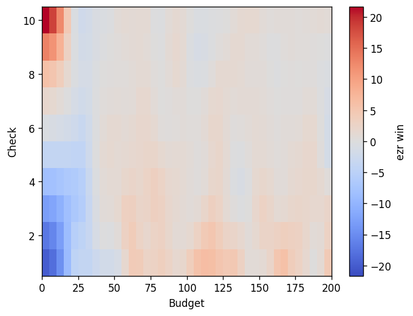
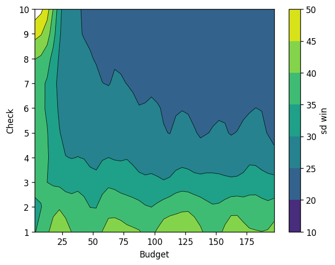
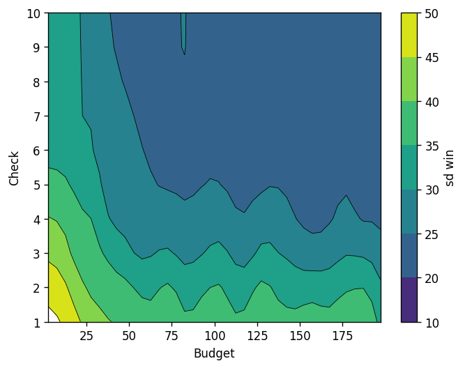
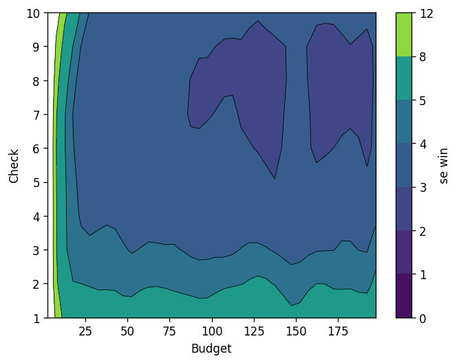
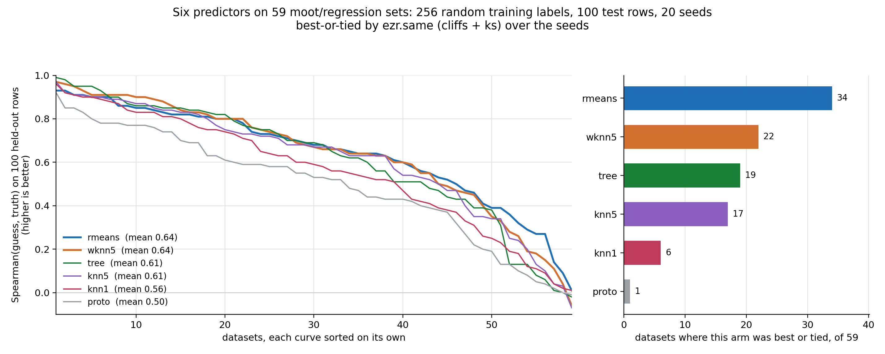
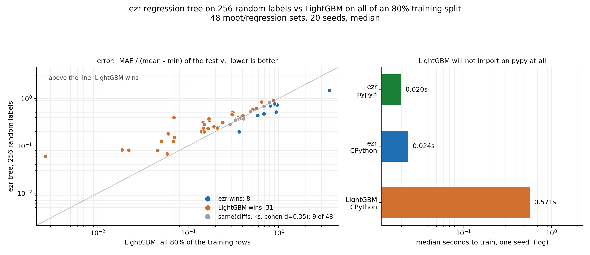

# rq: research questions for ezr/ezr0/ezr1

Data: `rq.py`; each run draws a random moot/optimize dataset,
Budget (10..200 labels), Check (1..10 test probes); score = win
(100 = found the best row, 0 = no better than average).

## RQ1: how much does a labelling budget buy?

25,000 paired runs per algorithm (pypy3.12, 10-way xargs, ~5
min/arm).

**Fig 1: ezr0** (whole budget spent at random, up front)

**Fig 2: ezr** (one label picked after each label)

**Fig 3: ezr minus ezr0** (red: ezr wins; blue: ezr0 wins)

- **Check dominates Budget.** Win climbs steeply with Check
  everywhere; past Budget ~50, more labels barely help.
- **Very little delta ezr vs ezr0.** Over most of the map the
  difference is within noise (±3 wins). Sequential labelling
  buys nothing once labels are even modestly plentiful.
- Both exceptions sit at Budget < 25: ezr wins (+20) at Check
  9..10; ezr0 wins (-20) at Check 1..5. Active learning only
  pays when labels are very scarce, and hurts there if too few
  checks are held back.

### RQ1a: how stable are these wins?

**Fig 4, 5: sd of win** (ezr0, ezr); **Fig 6: se of the mean**

- **The means are solid.** Standard error is 2..5 wins almost
  everywhere (Fig 6), so the 5-win contour steps of Figs 1..2
  are resolved; more runs would change nothing.
- **The spread is real, and it mirrors the mean.** Run-to-run
  sd is 20..25 on the high-win plateau but 40..50 in the
  label-starved corner: low-budget runs are not just worse on
  average, they are lottery tickets. Most of that sd is
  dataset heterogeneity (per-dataset means run 60..100), not
  sampling noise.

## RQ2: what do interpreter, parallelism, and layout cost?

500 runs per cell (small, so fixed costs understate the
parallel gain; at 25,000 runs xargs-10 gave ~5x).  All sixteen
cells were measured in one pass on one machine, so they are
mutually comparable; they supersede an earlier run whose
absolute times ran ~15% faster.

Each cell reads `o(dict)` -> `__slots__`: the same program with
`Num`/`Sym` as plain classes rather than dict subclasses, and
`type(col) is Sym` rather than `"has" in col`.  Only the columns
changed; `the`, tables and tree nodes are still `o(dict)`, which
needs `in`, `[]` and `.update` on what it also reads with a dot.
Byte-identical output on all 127 datasets, and on every demo and
rig.

Cells are seconds:

| dict→slots | ezr0 serial | ezr0 x10  | ezr serial | ezr x10   |
|------------|-------------|-----------|------------|-----------|
| python3    | 109.6→75.5  | 56.7→39.3 | 135.6→89.4 | 66.0→41.3 |
| pypy3.12   |  27.8→18.6  | 15.7→12.0 |  34.4→22.0 | 19.3→13.8 |

- Four independent levers that multiply: pypy3.12 ~4x; xargs-10
  1.6-2.2x here (more at scale); ezr0 over ezr ~1.2x;
  `__slots__` 1.3-1.5x for ezr0, 1.5-1.6x for ezr.
- pypy does *not* absorb `__slots__` (1.49x on pypy serial for
  ezr0, 1.56x for ezr), which is the opposite of what we
  expected.  Escaping `o(dict)` wins on writes -- Welford sets
  four fields on every numeric add -- as much as on reads, and
  a JIT cannot specialise away a `__setattr__` that must run.
- ezr gains more than ezr0: its tree builder adds into fresh
  `Num()` accumulators for every candidate split, so it leans
  on column writes even harder.
- Worst to best, (serial, python3, ezr, dicts) to (xargs-10,
  pypy3.12, ezr0, slots): **11x** (135.6s to 12.0s).  Without
  `__slots__` that same span is 8.6x (135.6s to 15.7s).

## RQ3: does contrast (ezr1) optimise as well as ezr and ezr0?

`ezr1.py`: bin every x value once (5 bins; symbols as is); score
each (column, bin) range by b^2/(b+r) (b, r = shares of best and
rest labels in it); merge ranges into rules with WHICH (100 merges,
top 32 kept; OR within a column, AND across). To optimise, rank
unlabelled rows by the summed scores of the top 10 rules they meet
(ties: nearest the best rows' modal bins), label the top Check,
keep the best. The same rules also explain (the ranges table, the
top rule) and plan (move a row's broken columns to the top rule).

Holdout: train on half, rank the other half, Check=5; Stop = total
labels; 128 moot files x 20 repeats, same splits for all three.
Best-or-tied = best mean, or indistinguishable from it by
`ezr.same` (cliffs + ks) over the 20 repeats. Data:
`etc/budget.txt` (`./ezr1_eg.py --budget`).

| Stop | mean win (ezr1 / ezr0 / ezr) | best-or-tied files | secs |
|---|---|---|---|
| 20  | 71.3 / **72.5** / 69.0 | **101** / 97 / 75 | 402 / 680 / **201** |
| 50  | **78.4** / 77.7 / 77.9 | **90** / **90** / 85 | **408** / 683 / 578 |
| 100 | **81.4** / 79.8 / 81.3 | **92** / 66 / 87 | **424** / 691 / 1001 |

- **ezr1 is recommended.** Best-or-tied on the most files at
  every budget (70-79% of files); means level with or above both.
- **Its cost is flat.** ezr1 takes ~400s at any budget; ezr's
  active learning grows 5x from 20 to 100 labels.
- Planning (from `etc/run.txt`, `ezr0_cmp.py --rank`): ezr1's top
  rule matches ezr's tree on gain (24.9 vs 24.1 mean wins) with
  fewer columns changed (0.99 vs 1.25), 2.9x faster.

## RQ4: can ezr predict as well as it optimises?

RQ1-3 all score *optimisation*: find a good row.  RQ4 scores
*prediction*: guess a held-out row's y.  Nothing here uses active
learning -- both rigs label at random, and `ezr.grabs` is the
straw man ("same budget, taken at random").

**How.** Two rigs.

*Rig A, the bake-off* (`./ezr1_eg.py --learn`, data
`etc/learn_regress.txt`).  59 moot/regression sets.  Per seed:
shuffle, drop rows whose target is "?", train = the first half
capped at 256 rows, test = the first 100 of the other half.
Score = Spearman(guess, truth).  20 seeds.  Five of the six arms
read binned values (`-Bins=5`, numerics cut on the logistic norm
`1/(1+exp(-1.7z))`, z clipped to +-3); `tree` reads raw cells.

| arm | what it does |
|---|---|
| `knn1`,`knn5` | k nearest by `g2` = squared gap in bin widths, summed over x (a `"?"` is `Bins^2` away); guess = mean of their y |
| `wknn5` | the same, with each column scaled by its variance reduction |
| `proto` | halve on a fastmap pole until < 8 rows, store each leaf's mean, guess with the nearest training row's leaf |
| `rmeans` | per column, the mean y of the training rows in this row's bin, pulled toward the grand mean by an m-estimate (m=2); columns averaged by variance reduction |
| `tree` | `ezr.tree`: every column, every cut point, score = n-weighted sd of the two sides, `Leaf=4`, grown out, guess = leaf mean |

*Rig B, against a real gradient booster* (`etc/arms.py`, data
`etc/arms.tsv`).  48 sets, 80:20 split, 20 seeds.  ezr gets 256
random labels and `Leaf=sqrt(n)`; LightGBM gets **all** of the
80%, every row of it, and its own defaults.  Error = MAE over
(mean - min) of the test y, so sets are comparable.  The three
arms share a seed, so CPython and pypy deal identical rows -- and
they do: the two ezr columns agree to 1e-9 on all 48 sets, which
is what makes the pairing checkable.

**Fig 7: six predictors, each sorted on its own**

- **`rmeans` wins**: best-or-tied on 34 of 59, ahead of `wknn5`
  (22), `tree` (19), `knn5` (17), `knn1` (6), `proto` (1).
- **But `rmeans` and `wknn5` are the same curve** for the first
  two thirds of the sets (both mean 0.64).  `rmeans` pulls ahead
  only in the hard tail, where its pull toward the grand mean
  stops a thin bin from inventing a prediction.  The win count
  overstates the gap; the profile shows it.
- **Weighting columns beats adding neighbours.** `wknn5` > `knn5`
  > `knn1`, and the step from `knn5` to `wknn5` costs nothing but
  the weight vector `rmeans` already computes.
- **The tree is mid-pack.** It is the only arm that commits to one
  column per level, and on 256 labels the deep levels starve.
- **`proto` is last on every segment of the curve.** Unsupervised
  leaves cost 0.14 of mean Spearman against looking at labels.

**Fig 8: ezr tree on 256 labels vs LightGBM on everything**

- **LightGBM wins the accuracy, 31 to 8, with 9 unseparable.**
  Median error gap +0.036 (quartiles +0.003, +0.074).  No
  surprise: it reads the whole 80%, ezr reads 256 rows.
- **ezr only wins where nothing works.**  On the 31 sets LightGBM
  takes, its own median error is 0.17; on the 8 ezr takes, 0.86.
  Those eight (`cleveland`, `echomonths`, `hungarian`, `lowbwt`,
  `meta`, `pharynx`, `servo`, `veteran`) are the sets where the
  target is barely predictable at all, and ezr's flatter
  predictor is simply less confidently wrong.
- **The cost is 24x the other way**: 0.024s (CPython) and 0.020s
  (pypy) against 0.571s.  And LightGBM is a C extension that will
  not import on pypy at all, so RQ2's 4x interpreter lever is
  available to one arm only.  That is a result, not an
  inconvenience.

**Frugal trees do not help regression** (`attic.py --fft`, 56
sets, d=5, ~36 variants per tree).  Shopping the collapsed spines
for the one with the lowest training error:

| scored on | frugal beats tree0 | median gap |
|---|---|---|
| training error | 1 of 56 | +0.092 |
| test error     | 19 of 56 | +0.022 |

Median error, train then test: tree0 `0.165 -> 0.292`, the frugal
spine `0.274 -> 0.334`.

- Collapsing can only lose training error, so the 1-of-56 is
  arithmetic, not a finding.  The test column is the finding:
  frugal loses on 37 of 56, median 0.022 worse.
- It does **generalise** better in relative terms -- tree0 decays
  77% from train to test, the frugal spine 22% -- but it starts
  so far behind that the smaller decay never catches up.  What
  frugalling buys is a tree you can read in five questions, not
  a better one.

*Reproducibility note.* `learn_regress.txt` was generated at
`da8e1d3`, when `ezr.ranker` returned "its leaf's mean ydist"
(lower = better), which is why `ezr1_eg.py:232` negates it.
`ranker` now returns the leaf's mean y, so that negation is stale
and would invert the `tree` column; the recorded numbers match the
un-negated value (auto93 +0.80 against the file's 0.79).
`ezr1.py:51` is also mid-edit and does not parse, so `--learn`
will not run until both are fixed.

## Conclusion

Label a few dozen rows any way at all, hold back a handful of
checks, and pick on validation: that simple recipe matches the
clever one except in the label-starved corner (RQ1). And the
whole study is cheap: pypy plus ten processes turns an
afternoon of compute into minutes (RQ2). And contrast alone
(ezr1: ranges, rules of ranges) optimises as well as either,
at a flat cost, while also explaining and planning (RQ3).  For
prediction rather than optimisation the ranking flips: a one-pass
weighted average of per-bin means (`rmeans`) beats the tree, and
a real gradient booster beats both on accuracy while costing 24x
the time and giving up pypy entirely (RQ4).
